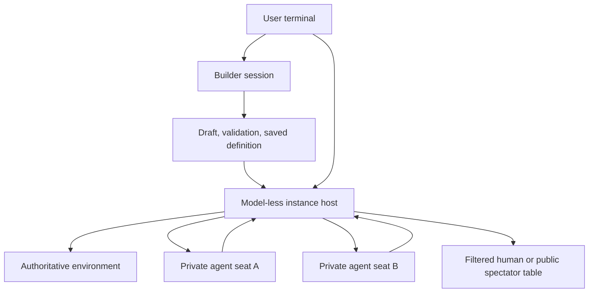

# Prime Environment Harness: current behavior

This guide describes the implementation in this checkout on 2026-10-04,
including environment-controlled attention and N-seat runs from
[Review environment wake plan](codex://threads/01a102d7-b0c1-7e11-a166-451b1bfc9339)
and terminal forms from
[Design lightweight environment UI](codex://threads/01a102da-38e9-7210-a300-87c05aad0bcc).
The [verification record](../VERIFICATION.md) separately records checks run and
outstanding merge-gate blockers.

## Contents

- [Launch and builder skill availability](#launch-and-builder-skill-availability)
- [Definitions, instances, and session roles](#definitions-instances-and-session-roles)
- [Build, validate, save, and enter](#build-validate-save-and-enter)
- [Participants, rosters, and models](#participants-rosters-and-models)
- [Environment code and schemas](#environment-code-and-schemas)
- [Notifications and automatic agent turns](#notifications-and-automatic-agent-turns)
- [Human actions and setup forms](#human-actions-and-setup-forms)
- [Communication and privacy](#communication-and-privacy)
- [Execution policy, Python, and integrations](#execution-policy-python-and-integrations)
- [Run controls, limits, and completion](#run-controls-limits-and-completion)
- [Persistence, restart, and recovery](#persistence-restart-and-recovery)
- [Builder management and diagnostics](#builder-management-and-diagnostics)
- [Command reference](#command-reference)
- [Implementation ownership and verification](#implementation-ownership-and-verification)
- [Current boundaries and troubleshooting](#current-boundaries-and-troubleshooting)

## Launch and builder skill availability

Prime Environment Harness is the `prime-env-harness` application in this Rust
fork of Prime Agent. The retained `prime-agent` binary represents the upstream
surface. The environment app has its own daemon, settings, credentials, history,
environment store, and worker descriptors under `~/.prime-env-harness` by default.

From the source checkout:

```sh
cargo run -p pa-cli --bin prime-env-harness
```

After building, launch the binary from another directory:

```sh
cd ~
/absolute/path/to/prime-env-harness/target/debug/prime-env-harness
```

Cargo can build and launch from another directory without changing the agent's cwd:

```sh
cd ~
cargo run --manifest-path /absolute/path/to/prime-env-harness/Cargo.toml -p pa-cli --bin prime-env-harness
```

Use `--data-dir /absolute/path/to/data` or `PRIME_ENV_HARNESS_DATA_DIR` to choose
another root; the command-line flag wins. The app canonicalizes the root, sets
owner-only permissions on Unix, and keeps its session directory and daemon
socket inside it. The root cannot be the home directory itself or an ordinary
Prime data directory under `~/.prime`. Launch directory and data directory are
different: launching from home with storage in `~/.prime-env-harness` is supported.

Run `/login` in the builder to configure a provider and `/model` to select a
model. Local environment workers need Node 22.20+ for TypeScript or Python 3.10+
with venv support for Python. Docker needs a running daemon and permission to
prepare images. `PRIME_ENV_PYTHON` can select the local environment Python
executable; otherwise the runner probes supported Python commands. The builder
REPL has its own Prime Agent runtime and skill
bootstrap, independently of participant Python capability.

The fork disables upstream installers in CLI/TUI update flows. Its current
update path is rebuilding the checkout; no fork release channel is provisioned.

### Instructions outside the checkout

The builder prompt includes the environment-harness purpose, skill inventory,
and normal builder context. These bundled skills provide the environment rules:

| Skill | Purpose |
| --- | --- |
| [`env-harness`](../skills/env-harness/SKILL.md) | Commands, policies, rosters, spectators, controls, resume, and recovery |
| [`environments`](../skills/environments/SKILL.md) | SDK authoring, roles, schemas, attention, checks, saving, and authorized provisioning |

Bundled discovery looks for `skills/` under the package directory, then falls
back to `skills/` in the compiled source checkout. The package directory is
`PI_PACKAGE_DIR` when set, otherwise the executable's directory. These paths
are independent of cwd. The prompt supplies absolute SKILL.md locations.
The `environments` skill is also an importable Python package; kernel bootstrap
installs the resolved package for builder management calls.

Authoring references and a complete relay example live inside the skills tree.
The builder resolves them relative to the discovered skill. Draft creation embeds
the current SDK and runner, so writing an environment does not require locating
`crates/` from the user's directory.

A moved binary must retain runtime and skill assets. Keep complete
`skills/env-harness/` and `skills/environments/` directories, including references,
assets, `pyproject.toml`, and Python sources. SKILL.md alone cannot provide
executable management. User copies under `<data-dir>/skills/` also work. The
source fallback works while the compiled checkout exists; a copied executable
alone is not a self-contained distribution.

User/project overrides retain their normal precedence. Disabling built-in skills,
excluding these skills, pointing at an old package, or overriding a skill name
can change the inventory. The harness respects those settings.

Inspect the effective prompt without a provider call:

```sh
/absolute/path/to/prime-env-harness --data-dir /tmp/harness-prompt-check prompt --json
```

Expect `harness-purpose` and `skills-inventory` segments, with `env-harness` and
Python-importable `environments` at readable absolute locations.
[`verify_environment_skills.py`](../scripts/verify_environment_skills.py) checks
an unrelated cwd, a temporary home cwd, and a staged package, including skill
references and Python package assets.

## Definitions, instances, and session roles

An environment is a Python or TypeScript program that owns rules/state and
publishes JSON observations and schema-defined actions. The host determines the
acting seat and grants; environment code determines legality and private views.

| Concept | Meaning |
| --- | --- |
| Draft | Editable manifest, code, resources, dependency locks, SDK, runner, and checks |
| Definition | Immutable content-addressed version of a validated draft |
| Instance/run | One execution pinned to a definition version, policy, roster, state, and history |
| Role | Domain permission, such as player, reviewer, buyer, or seller |
| Seat | Individual identity occupying a role in an instance |
| Occupant | Human or agent assigned to a seat |
| Builder | Normal agent that creates definitions and provisions authorized runs |
| Host/table | Supervised, model-less session owning the instance and user view |
| Agent-seat session | Separate supervised model session with private context and restricted tools |

Entering switches the user's attachment to the table host. The builder does
not become a player. Each agent seat has separate model calls, observations,
transcript, wake inbox, and optional Python namespace. The host has no model or
builder kernel.



The ordinary builder retains Prime Agent's persistent REPL, file/code tools,
RLM subagents and messaging, skills/MCP, compaction, durable harness state and
refinement, goals, and background scheduling. Environment agents receive a
seat-specific prompt and actions instead of general coding, recursion,
scheduling, or management tools. Environment attention works through committed
deliveries, independently of builder goals or heartbeats.

### Builder capabilities retained from Prime Agent

The current builder prompt presents `ipython`, a persistent Python REPL, as its
native model tool. Bash, editing, RLM operations, skill modules, and MCP calls
are programmatic interfaces inside that REPL. Top-level await is supported;
Python variables can carry working state between cells. A Bash call starts a
separate process and does not preserve shell state between calls. Background
completion messages and session events return through the harness.

| Builder area | Interface and purpose |
| --- | --- |
| Commands and editing | Programmatic bash/edit tools operate on the builder's cwd and filesystem |
| Recursive agents | rlm.spawn creates named children; model/thinking can inherit; find_models, collect, list_subagents, delete_subagent, create_session, and progress_note support orchestration |
| Agent communication | agent_message.send and agent_observe expose reachable family messaging/status/previews |
| Skills | Markdown instructions and optional importable Python packages resolve from configured resources and bundled assets |
| Generic MCP | The pre-imported mcp object handles discovery/calls; enabled server guidance enters the prompt |
| Context management | /compact and the compact skill summarize conversation; they do not change the environment snapshot |
| Durable harness state | rlm.harness manages memories, skill references, subagent definitions, and prompt notes, with refinement history |
| Refinement | /refine and the refine skill can update supplemental harness state; the immutable base prompt remains unchanged |
| Goals | /goal and the goal skill track a persistent objective and its budget/progress |
| Background work | Heartbeats, schedules, and autonomous settings continue builder work under their configured limits |
| Images | attach_image supplies image context through its skill |
| Model/session management | /model, provider login, session attach/resume, and daemon status remain normal builder operations |

General builder subagents can help implement an environment. They are distinct
from participants: seats use restricted tools, durable environment bindings,
host-selected wakes, and their own supervised lifetimes. Spawning a builder
subagent does not add a seat to a running roster.

Builder context and settings still depend on the launch directory. Resource
loading reads the app's global context, then ancestor project AGENTS.md/CLAUDE.md
files, configured packages, skill/prompt resources, and overrides. That changes
project guidance without making bundled environment instructions cwd-dependent.
Using the home directory therefore loads whatever applicable home/ancestor
context exists, while drafts and instances remain in the selected data root.

### Prompt assembly

The cache-stable prefix contains core harness/API description, mandatory usage
rules, opinionated guidance, and any per-model instructions. One dynamic tail
then supplies harness purpose, packages, project context, skill inventory, MCP
servers, environment information, session role, and supplemental/appended guidance.
The harness digest remains a separate user message. The prompt command reports
this layer breakdown and assembled text without starting a provider session.

The environment purpose in the dynamic tail tells the builder to load the
environments skill for authoring and env-harness for operations. Supporting
references are read when relevant; they are not all pasted into every prompt.
Agent seats instead receive the environment's instructions, role/identity,
permitted actions, peers, and Python grant in their restricted participant prompt.
That prompt also lists the instance's resolved setup configuration (defaults
plus overrides, read from the initialization receipt so it survives resume,
restart, and compaction; omitted with a note above 8 KiB), and the run's deadline
and output-token cap.
The table host runs no model prompt.

## Build, validate, save, and enter

1. Describe the environment in builder chat or use `/env create <description>`.
   Creation allocates a draft and writes current SDK/runner, starter environment,
   dependencies, and checks. Creation itself does not execute generated code.
2. Before writing code, the builder holds a design conversation. It raises the
   open decisions on rules, participants, turn flow and wakes, run length and
   configuration, privacy, agent context, deadlines and token budgets, failure
   handling, and analysis, with a recommendation for each. The user may decide
   or defer each one. The builder confirms a short design summary. See the
   packaged [design conversation](../skills/environments/references/design.md).
3. The builder implements rules, roles, observations, actions, attention, setup,
   resources, and checks. New drafts use protocol 2.
4. The builder explains purpose, actions, dependencies, requested participant
   Python, and execution recommendation. The user selects policy. The builder
   applies it through `environments.select_policy`, or the user types
   `/env policy <draft> <json>`.
5. Validation prepares dependencies and runs the selected backend. No separate
   approval is needed after policy selection. The initial attempt plus three
   repair passes are allowed, with retained reports.
6. Save the passing unchanged draft with `environments.save_environment` or
   `/env save <draft> <id>`. Saving never starts an instance.
7. `/env enter <id>` opens setup with an execution choice. Submission creates
   the run. Explicit policy/roster commands can start directly. Initialization
   notices start eligible agents.
8. Act, chat, message, observe, or control the table. Leave/resume the same instance
   later, or start another from the saved definition.

Policy selection lives outside generated source and is tied to the manifest;
manifest changes invalidate it. Hashed source changes after validation invalidate
saving. A saved definition keeps validation policy/report, while an instance keeps
its own selected policy/version.

Generic validation checks manifest/roster constraints, action schemas,
initialization using setup defaults, seat observations, and snapshot equality
after restore in a fresh worker. Requested/granted participant Python receives
bridge and namespace restoration checks, followed by `checks.py` or `checks.ts`.
Domain rules, privacy, roster variants, and wake choreography need meaningful
behavioral checks. Counter scaffold checks cannot verify a replacement game.

## Participants, rosters, and models

Protocol 2 supports 1–16 total seats and at most one human. Every declared role
must have its minimum to maximum seats and permit their occupants. Role minima
are positive; optional zero-seat roles are unsupported. Role names and IDs use
1–64 ASCII letters, digits, hyphens, or underscores. IDs are unique; roles may
be shared by several seats.

| Arrangement | Requirement | User view |
| --- | --- | --- |
| One human alone | Role minima satisfied by one human | Human observation/forms; no model turns |
| One agent alone | Role minima satisfied by one agent | Optional public spectator view |
| One human and one agent | Valid shared or different roles | Human view and addressed/public notices |
| One human and multiple agents | One human plus up to 15 agents | Same human table, independent model seats |
| Several agents, human watching | All-agent roster | Public events/status and oversight controls |
| Several agents, nobody watching | Same all-agent roster | Autonomous host/seat interaction; watch later |

Domain code receives IDs/roles and can serve these mixtures without knowing
occupant kinds. A required human-only role prevents agents-only use; an
occupant-flexible player role supports both.

The default roster fills each role's minimum in manifest order, assigning the
first eligible seat to a human and the others to agents. Agent-only roles yield
no human. Explicit rosters choose another mixture or more seats than the minimum.
Omitted IDs become `<role>-<index>`.

For the packaged relay's `player` role:

```text
/env enter relay local {"seats":[{"id":"you","role":"player","occupant":"human"},{"id":"alice","role":"player","occupant":"agent"},{"id":"bob","role":"player","occupant":"agent"}],"limits":{"max_operations":100}}
```

This starts directly with setup defaults. For configuration plus roster:

```text
/env enter relay {"policy":{"backend":"local"},"roster":{"seats":[{"id":"you","role":"player","occupant":"human"},{"id":"alice","role":"player","occupant":"agent"},{"id":"bob","role":"player","occupant":"agent"}],"limits":{"max_operations":100}},"setup_arguments":{"rounds":2}}
```

For agents only, make every occupant `agent`. Optional agent `model` and `thinking`
inherit the builder's choices when absent; explicit values must be accepted by
catalog/allowlist. Human seats cannot set either. The setup form does not edit
rosters/models; use explicit JSON or builder provisioning.

## Environment code and schemas

Python exports `environment`; TypeScript exports a default environment object.
Methods can be synchronous or asynchronous and use JSON values.

| Method | Responsibility |
| --- | --- |
| `initialize(params)` | Receive `{"seats":[{"id":...,"role":...}],"config":...}`, create state, emit initial attention |
| `describe_actions()` | Public names/descriptions, input/output schemas, permitted roles |
| `observe(seat)` | Read the seat's filtered view |
| `handle_input(seat, text)` | Process text; return `{"observation":...}`, choose notices |
| `invoke(seat, action, arguments)` | Check domain legality, mutate, return valid output, select attention/progress/finish |
| `snapshot()` | Serialize all authoritative continuation state |
| `restore(snapshot)` | Reconstruct in a fresh worker without repeating initialization/effects |
| `dispose()` | Release resources |

The host binds the actor; arguments cannot override identity. It checks schemas
and role permission. Code checks turn order, remaining moves, ownership, funds,
and other domain legality before mutation. Protocol 2 action descriptors use
`roles`, not legacy `participants`.

Action descriptors are shared metadata. Keep secret hands, bids, and private
choices out of descriptions/enums/schemas. Filter observations in code. Reads,
snapshots, restore, and disposal cannot schedule turns or emit mutation metadata.

`setup_schema` defines domain configuration separately from policy/roster.
The host applies property defaults and validates before initialization. Required
setup properties need valid defaults for automatic validation. Without a setup
schema, only empty configuration is supported.

Python dependencies use exact pins and hashes in `requirements.lock`.
TypeScript uses `package.json`/`package-lock.json`, prepared with
`npm ci --ignore-scripts`; Node executes native type-strippable TypeScript.
Include required resources in the draft. Creation supplies SDK/runner assets
independently of cwd.

The packaged [authoring contract](../skills/environments/references/contract.md)
has detailed requirements. The [relay example](../skills/environments/assets/relay/environment.py)
includes manifest and behavioral checks for the arrangements above. Source
fixtures also include counter, cards, documents, relay, and sealed bids; they
are test fixtures, not automatically saved catalog entries.

## Notifications and automatic agent turns

After a mutation, code decides which seats need attention through the SDK:

```python
from sdk import notify, progress, finish

notify([next_seat], "Your turn")
notify([human_seat], "Choose your next move", wake=False)
notify("*", "A trade was accepted", wake=False)
progress(revision, waiting_for=[next_seat])
finish("The game has ended")
```

TypeScript uses `notify(to, message, { wake: false })` and
`progress(revision, { waiting_for: [...] })`.

| Attention | Visibility | Scheduling |
| --- | --- | --- |
| `notify([seat_id], text)` | Target only | Private turn if target is agent |
| `notify([seat_id], text, actionable=True)` | Target only | Private turn; retired if the environment no longer awaits the seat |
| `notify([seat_id], text, wake=False)` | Target only | Delivery without turn |
| `notify("*", text, wake=False)` | All seats and spectators | Public update, no turn |
| `notify("*", text)` | All seats and spectators | Wakes agent seats |
| `progress(revision, waiting_for=...)` | Host progress/wait state | Does not schedule turns |
| `finish(summary)` | Public terminal summary | Stops seats, blocks mutations |

`actionable=True` marks a wake as the task a seat should act on now. A wake can
wait behind the seat's running turn; when its turn starts the host checks each
actionable task against the environment's published wait state. A task is
retired when `progress(waiting_for=...)` no longer names the seat, or when a
newer actionable task for the seat was committed with the current wait state.
A wake left with no wake-worthy delivery settles durably without a model
request; a wake that still carries a private message, direct message, ordinary
notice or current task runs with the retired tasks removed. A task is never
withheld from the seat the environment awaits: with no newer task, an older one
stands. It requires `wake=True` and named seats. The environment decides the
tasks and recipients; the host only revalidates them.

Target IDs identify seats, not roles. Lists contain 1–16 unique existing IDs.
A list of every seat remains targeted; spectators get only explicit `"*"`
events. Messages allow 16 KiB each and 64 notices per operation. Wake defaults
to true; narration normally needs false.

Human-targeted notices display in the table. Humans choose and submit their
own actions; a wake cannot press buttons or decide for them. There is no OS
notification or arbitrary environment timer/callback API.

### Commit and delivery

1. Host binds the actor, checks admission/schema/role constraints, and fsyncs
   the operation intent before dispatch.
2. Code returns result and buffered attention metadata.
3. Runtime validates and commits receipt, notices, progress/finish, and snapshot
   together.
4. Host materializes stable events in `table.jsonl` with ordered delivery sequences;
   partially materialized operations can continue after restart.
5. Unseen agent wake deliveries are combined with a fresh filtered observation
   and admitted to that seat's durable inbox.
6. Seat journaling precedes acknowledgment. Host advances its delivery cursor
   only after acceptance; the worker runs its restricted model turn.
7. Seat start/settlement/failure reports update host state. Subsequent committed
   notices can continue without a human prompt or builder relay.

Wakes can coalesce; one notice does not necessarily equal one model turn.
Non-wake deliveries can accompany a later wake. Observation reflects current
state at dispatch rather than a historical view per notice. Environment mutations
are serialized even if multiple models are active concurrently.

An assistant reply, changed observation, returned action result, or mention of
another seat does not itself wake peers. Use explicit notices or messaging.
Metadata can be emitted only by initialize/invoke/handle_input. If a successful
response has malformed output/attention after state changed, recovery may be
required; validate before mutation.

### Agent context

The manifest's `agent_context` decides what a model request contains. Under
`"conversation"` (the default), each wake is appended to the seat transcript,
and the whole transcript is resent on every request, so cost grows with the
square of run length. Under `"stateless"` (protocol 2), a request holds only
the system prompt with `instructions`, the latest wake, and the current turn's
own tool calls. The wake carries `{"state": agent_view(seat), "messages": [...]}`,
where messages are targeted notices and direct messages, not `"*"` broadcasts.
`agent_view` defaults to `observe` and is limited to 32 KiB at validation and
at wake time.

Stateless seats have no `observe_environment` tool. Action results return
`{"result": ..., "state": ...}`, and a rejected action returns its error with
the current state. A wake that waited while the seat's previous turn ran gets
a fresh view when its turn starts, in both the prompt and the stored transcript.
Transcripts are always stored in full; stateless mode only changes what is
resent. Only a wake still queued merges with a newer one; a wake already handed
to the model is never merged again.

### Acting on the state a model was shown

Every model-generated mutation (`env_<action>` and `say`, and `env.invoke` from a
seat's Python) is bound to the committed state its model request was generated
from. The binding is a host-owned version carried outside the model's arguments:
the instance's checkpoint operation sequence, which advances with every engine
operation receipt (an action or input, including a rejected or read-only one) and
with nothing else. `observe` and `agent_view` create no receipt, so reads never
invalidate a view; turn accounting, direct messages and Python namespaces are not
engine state. Each wake, `observe_environment` result and refreshed view carries
the version it was read at, atomically.

The host compares the version to the committed state under the same lock that
serializes mutations, before any environment code runs. A mismatch is refused: a
structured `stale_view` reply with the current view and its version, nothing
executed, no receipt, no intent. The refused call is never replayed; the model
must reconsider and call again. Consequences by design:

- All calls of one response share the version of the request that wrote them. A
  later call of the same response is refused once an earlier one commits, and the
  state a tool returns, or a wake queued behind the turn, only governs later
  requests.
- A repeated operation ID returns its original receipt before any stale check, so
  retries after a lost reply and restarts keep their recovery behavior.
- A seat's Python cell is bound to the view that wrote it and never rebinds: once
  an operation commits, including the cell's own, later `env.invoke` calls raise
  an error that mentions the stale view. `env.observe` inside the cell does not
  rebind it.
- Simultaneous seats invalidate each other's views, so a model that is refused
  reconsiders from the fresh view it receives. A seat acting on a view that was
  stale when it started its turn is refused the same way.
- Human forms bind to the observation displayed when they were opened. A stale
  submission is rejected, the refreshed state is shown, and the form's values are
  kept for the human to review and submit again; arguments are never silently
  rebound.

### Coordination patterns

Sequential play initializes by waking the first legal seat. Each move advances
state/revision, publishes a safe update, and wakes the next legal seat, reporting
it in `waiting_for`. Include the human there during a human turn. Finish at the
terminal move instead of scheduling another turn.

Simultaneous rounds wake eligible submitters initially, record submissions
privately, and remove completed seats from `waiting_for`. Resolve only after all
submissions arrive. Publish permitted aggregate results, then finish or wake
next-round submitters. Avoid re-waking everyone after each partial submission.

Negotiation uses handle_input to decide visibility, domain changes, and who must
answer. Advance revision when proposals/agreements change state; avoid reciprocal
wakes without progress. Asymmetric roles target the individual seat owning the
next action. The packaged [coordination reference](../skills/environments/references/coordination.md)
includes one-seat, mixed, and agents-only patterns.

## Human actions and setup forms

One lightweight terminal panel handles setup and actions. Click `[ Actions ]`
or type `/env act` for the action picker; `/env act <name>` opens a form directly.
`/env act <name> <json>` still submits directly.

| Schema | Control |
| --- | --- |
| String | Text editor; Shift+Enter newline |
| Integer/number | Number editor; Up/Down change value |
| Boolean | Checkbox; Space toggles |
| Primitive enum | Single-choice list |
| Unique array of enum items | Multiple-choice checkboxes |
| Nested/complex field | Field-level JSON editor |
| Unsupported root schema | Whole-input JSON editor |

Titles, descriptions, defaults, required flags, bounds, and choices come from
schemas. Required fields appear first. Defaults are visible; a required enum
without a default starts unselected. Optional absence, false, zero, empty text,
and empty collections retain their distinct values.

Tab/Shift+Tab navigate fields/buttons; Enter advances from a field or activates a
focused button. Space chooses options, arrows navigate lists, Escape closes.
Mouse targets support choosing/editing/submission. Large panels show a bounded
window around focus. Opening through Actions preserves a draft chat message.

Selecting/editing does not execute anything. Submit validates and sends; pending
submission blocks duplicates. Success closes. Rejection retains values and shows
the error. Transport failure blocks more submits in that panel because outcome
may be uncertain; close it and inspect state before retrying.

`/env enter <id>` opens execution choice and setup fields with no backend silently
selected. Explicit policy still opens declared setup fields; explicit policy
with no schema starts directly. Explicit roster/full-request commands start
directly using supplied configuration or defaults. Resume restores state without
setup or initialization.

The [form guide](environment-forms.md) includes schemas and UI details. There is
no live private-choice protocol; published schemas must stay public. Domain code
can reject stale choices without discarding entered values.

## Communication and privacy

| Channel | Behavior | Visibility |
| --- | --- | --- |
| Human table chat | handle_input from human seat | Human observation plus code-selected notices |
| Agent `say` | handle_input from agent seat | Code-selected notices; sender result private |
| Targeted notice | Committed domain metadata | Named seats |
| Public notice | Committed domain metadata | All seats and spectators |
| `message_seat` / `/env msg` | Host channel bypassing handle_input | Recipient; agent recipient wakes |
| Agent replies/thinking | Model transcript | Private seat transcript |

Direct messages default to enabled. Manifest `direct_messages: false` forbids
them; roster can narrow permission. They target another existing seat, allow
16 KiB each, and cap new messages at 32 per sending agent wake turn. The human
counter has no model-turn reset, so its current bound is 32 new messages over
the run.
Duplicate IDs return the existing event. Disable the independent channel when
rules require regulated/public communication through actions or say.

The human table contains its observation, own action responses, public notices,
notices/messages addressed to it, and run status. Agent observations, tool arguments,
action/Python responses, assistant text/thinking, and streamed deltas stay in
private sessions and out of host frames/reconnect history. Legacy projection
also redacts private streams and compaction summaries.

Agents-only spectators see explicit public deliveries, not arbitrary private
seat observations. All-agent occupancy does not make hands/bids public.
Public notices, finish summaries, schemas, instructions, and human observations
must stay free of secrets.

Builder diagnostics have privileged private reads distinct from spectator access.
Display privacy does not hide saved files from the OS user. Local generated code
shares host-user filesystem permissions; use Docker and narrow grants for
adversarial or secret-state participants.

## Execution policy, Python, and integrations

Environment language, participant Python, and backend are independent. A
TypeScript engine can grant participant Python; a Python engine can offer actions
without a participant REPL. Docker is optional, including for Python.

```json
{"backend":"local","python_execution":false}
{"backend":"docker","python_execution":false}
{"backend":"local","python_execution":true}
{"backend":"docker","python_execution":true}
```

Participant Python requires manifest request and policy grant. The builder applies
the user's selection and preserves existing authorization for unchanged choices.
A recommendation is not permission. Docker errors never silently fall back to local.

| Policy field | Default | Effect |
| --- | --- | --- |
| `backend` | local | Local process or Docker |
| `python_execution` | false | Persistent Python per agent |
| `networking` | false | Runtime network policy; Docker enforces it |
| `mounts` | empty | Source/target/writable grants |
| `secrets` | empty | Named worker secrets |
| `integrations` | empty | Named host adapters |
| `call_timeout_seconds` | 120 | Runtime call timeout |
| `preparation_timeout_seconds` | 600 | Dependency/image preparation |
| `cpus` | 2 | Docker CPU bound |
| `memory_mib` | 1024 | Docker memory bound |

Policy objects replace rather than patch; omitted fields use defaults. Restate
grants to retain. Existing instances keep policy. Humans explicitly choose policy
for new runs. Builder provisioning can narrow validation policy but cannot switch
backend, add grants, or increase time/resource bounds.

Local Node/Python and participant kernels use host-user permissions. Brokered
tool allowlists do not confine direct file/network access; `networking: false`
does not create an OS sandbox for local code.

Docker separates engine and participant containers/scratch. Participants receive
kernel/action runtime without engine source/private workspace. Runtime containers
use non-root users, no capabilities, a read-only root filesystem, and resource
bounds. Dependency preparation is a separate network-enabled step. Explicit
mounts/grants expand access; store/configuration cannot be mounted into participants.

Provider credentials remain on the host. Worker secrets resolve from
`PRIME_ENV_SECRET_<name>` and only granted names reach workers. Never put
credential values in generated source/manifests.

### Participant tools and Python

Seats get `observe_environment`, `env_<action>` tools for their role, protocol-2
`say`, optional `message_seat`, and optional `ipython`. They cannot spawn players,
attach as builders, use builder management, or use general coding tools.

Inside participant Python:

```python
observation = env.observe()
result = env.invoke("action_name", {"argument": "value"})
lookup = env.integration("lookup", {"query": "value"})
```

The host binds identity. Observe/invoke use the same admission/control/limit
gate as seat tools. Each agent has separate namespace checkpoints, scratch, and
cell receipts; local filesystem permissions remain shared. Docker isolates access.

Python checkpoints retain pickle-compatible values. Modules/open files and other
unpickleable values are omitted/reported; values above 16 MiB are omitted and
snapshots cap at 256 MiB. Conversations and scratch are separate. The environment
JSON snapshot remains authoritative.

### Trusted integrations

User configuration is `<data-dir>/environment-integrations.json`. A named entry
contains absolute `program`, optional `arguments`, `input_schema`, `output_schema`,
and optional `secrets` mapping adapter env-variable names to secret references.

Environment SDK calls use
`host_call("integration.call", {"name":...,"arguments":...})`; participant Python
uses env.integration. The dispatcher checks grants/schema, injects bound instance/
participant identity, and executes the configured program with one JSON stdin
request. It validates the returned JSON stdout value. Generated code chooses an
allowed adapter name, never a command or caller identity.

Adapter secrets resolve from `PRIME_ENV_INTEGRATION_SECRET_<name>` on the host;
provider variables are not inherited. A dispatched adapter with uncertain
completion needs inspection of external receipts before recovery.

## Run controls, limits, and completion

`/env status` reports phase/reason, allowed observation, and human actions.
`/env seats` reports occupants/roles/models. Humans and agents-only spectators
can pause/resume/stop; spectators cannot act or send participant messages.

| Phase | Meaning |
| --- | --- |
| running | Dispatch/mutations admitted; a human wait can be legitimate |
| paused | User request, model/delivery failure, or resource bound; inspect before resume |
| stalled | No progress or unexplained quiescence; inspect attention/domain state |
| needs_recovery | Uncertain outcome requiring inspected reconciliation |
| stopped | User permanently stopped run |
| finished | Environment committed terminal finish |

Pause blocks new mutations, aborts models/signals Python, and retains pending
wakes. An action already holding the mutation gate may finish first; abort is
not rollback. Resume admits pending wakes and clears no-progress/busy bookkeeping.
Stop also stops seats permanently. Finished/stopped/recovery-required phases
cannot use ordinary resume controls.

| Run limit | Default |
| --- | --- |
| Domain mutations after initialization | 500 |
| Wakes per agent | 100 |
| Wall-clock lifetime | 7200 seconds |
| Time to action (`seat_turn_timeout_seconds`) | 120 seconds |
| Output tokens per model request, thinking included (`max_output_tokens`) | 8192 |
| Settled turns without revision change | `2 * agent_count + 2` |
| Re-prompts per awaited agent (`idle_turn_retries`) | 2 |

Limits live in the roster's `limits` object, are saved in `instance.json`, and
take the defaults above when omitted. They are per-run settings, separate from
the definition and from execution policy call/preparation bounds, so one
definition can run short probes and long matches. Roster `limits` accepts
positive bounds; `stall_turns: 0` chooses the derived default,
`idle_turn_retries: 0` disables re-prompting, and `max_output_tokens: null`
leaves the provider default. Operation/wake/time/turn bounds pause; no progress
stalls. Elapsed time starts at original creation and includes pauses. Resume
does not reset cumulative budgets, so an exhausted run can pause again
immediately. Each seat's prompt states its deadline and token cap.

The deadline bounds time to action. It runs only while progress metadata lists
the seat in `waiting_for` (or no metadata exists), and it restarts each time the
seat acts. The token cap is applied to every seat request; a thinking level
whose budget does not fit steps down. A turn that passes the deadline, or hits
the cap, without acting is aborted and its retained wake replays with thinking
off. A seat that already acted is not retried: its leftover turn is cut, counted
as a post-action abort, and spends no budget, and its next turn keeps thinking.

Progress revisions are nondecreasing. A changed revision resets no-progress
count at settlement; model replies/no-ops do not necessarily advance it.
When an agent turn settles while progress metadata still lists that seat in
`waiting_for`, the revision is unchanged since the turn started, and no newer
wake is pending for it, the host appends a targeted status wake re-prompting
the seat. Deadline retries and idle re-prompts draw on one per-seat budget of
`idle_turn_retries`; the seat acting, a revision change during its turn, or a
resume refunds it. Once the budget is spent, an idle turn stalls the run and a
timeout pauses it. Before stalling, the host checks for undelivered wakes. A run
also stalls when no seat is busy, no wake is pending, and no human wait explains
quiescence. Without progress metadata a human table retains the legacy human-wait
assumption; explicit metadata should describe actual waits.

`run.json`, also returned by `instance_status`, records per seat
`time_to_action` (count, total and maximum milliseconds from turn start to first
action), `deadline_retries`, `post_action_aborts`, and `idle_retries`, alongside
operation and wake counts.

Host polling enforces bounds/drains deliveries; it is not a domain tick API.
Finish/stall/recovery transitions inform the originating builder through a
session message, without granting participant/control tools.

## Persistence, restart, and recovery

The store is under `<data-dir>/environments/`:

```text
environments/
  drafts/<draft-id>/                    editable code and dependencies
  definitions/<id>/<hash>/              metadata and immutable source
  prepared/                            backend dependency caches
  validation/<draft-id>/                attempts/latest report
  instances/<instance-id>/
    instance.json                      pinned version, policy, roster
    owner.lock                         exclusive active owner
    checkpoint.json                    snapshot, receipts, attention, finish
    operations/                        engine intents
    workspace/                         engine scratch, separate from seat scratch
    run.json                           phase/counters/wake/settlement state
    table.jsonl                        all durable routed deliveries
    view-cursor.json                    human/public view cursor
    deliveries/<seat-id>.json           acknowledged seat delivery cursors
    host-conversation.jsonl             allowed table history
    host-session.json, host-config.json host identity and restart config
    builder-session.json, builder-token.json originating builder/capability
    seats/<seat-id>/
      conversation.jsonl               private model transcript
      session.json, token.json          session/capability
      inbox.json                       accepted/settled wake state
      participant/                     scratch/optional Python checkpoint
      python-operations/               cell intents
      python-receipts.json              cell outcomes
```

Files appear as features run; worker/session sidecars also exist. V1 retains
root-level participant Python and conversation paths. Builder sessions live in
the app's sessions directory. `table.jsonl` contains targeted/private events,
so it is not a safe public export; APIs filter spectator visibility.

Definitions are content-addressed with integrity checks. New runs can select
a saved version; existing instances stay pinned regardless of later saves.
Creation timestamps support newest-first selection; legacy metadata falls back
to file creation/modification time.

The exclusive lock prevents concurrent owners. Supervised host/seat workers
restore state and re-adopt seats after restart. Accepted pending wakes can replay.
Stable notice IDs prevent duplicate table materialization, and incomplete final
lines can be repaired. Cursors advance only after durable acceptance.

Repeated operation IDs return recorded results. Seat scoping prevents cross-seat
tool-call collisions. A repeated logical move with a new ID is a new operation;
domain rules still matter. External effects are not unconditionally exactly once.

Human `/env leave` pauses, stops seats, releases the instance, and returns to the
builder. Builder `/env resume <id>` restores without setup/initialization; inspect
status and use resume_run if paused. Spectator leave keeps agents-only runs alive;
watch later. `/env watch` rejects human-occupied instances.

### Uncertain operations

Intents precede dispatch; receipt/snapshot commit together. Interrupted actions
or malformed successful responses that may have mutated state block ordinary
resume and are never automatically replayed. Uncertain Python cells require
evidence and reset of the affected namespace; other seat kernels are independent.

Inspect intents, state, authorized transcripts, and external receipts, then
use `/env recover <id> <json>`. The v2 fields include:

```json
{
  "snapshot": {"domain_state": "verified replacement state"},
  "receipts": {},
  "python_receipts": {},
  "seat_python_receipts": {},
  "reset_python_seats": [],
  "reset_python": false,
  "evidence": "Describe the actual state and external receipts inspected"
}
```

This is a field illustration, not a ready-to-submit reconciliation. Every
unresolved intent needs a matching inspected receipt, with matching ID/request.
V2 cell recovery supplies per-seat receipts and reset_python_seats; legacy Python
uses python_receipts/reset_python. Evidence must be nonempty. Recovery records
supplied outcomes without executing initialization/actions/cells. Do not invent
receipts or delete intents to clear the block. Restore the reconciled instance.

## Builder management and diagnostics

The builder's activity dock shows an Environments group beside subagents,
heartbeats and shells: one item per run the builder or one of its subagents
provisioned, never one per seat. Each run belongs to the builder that created it
(the identity stored in `builder-session.json`), whichever session later resumes
or stops it. The group lists running, paused and stalled runs; finished and
stopped runs leave it. Opening it lists the runs: Enter spectates an agents-only
run, a run with a human seat reopens through `/env resume`, and `x` stops the
run. Pause and resume remain table commands. Host and seat sessions are hidden
from the agents view, so the dock group is how a run is reached.

The importable skill calls validated Rust host handlers and returns JSON:

| Python method | Purpose |
| --- | --- |
| `create_environment(description, language="python", python_execution=False)` | Allocate embedded scaffold |
| `select_policy(draft, policy)` | Apply requested policy |
| `validate_environment(draft)` | Prepare/run checks |
| `save_environment(draft, id)` | Save passed unchanged content |
| `list_environments()` | Saved versions |
| `start_instance(definition, seats, limits=None, policy=None, config=None)` | Authorized daemon provisioning |
| `list_instances()` | Persisted instances |
| `instance_status(instance)` | Run state |
| `pause_instance(instance)` | Pauses a run |
| `resume_instance(instance)` | Resumes a paused or stalled run on a live host |
| `stop_instance(instance)` | Permanently stops a run and its seat sessions |
| `observe_seat(instance, seat)` | Privileged filtered seat observation |
| `seat_transcript(instance, seat, since=0)` | Private transcript after line offset |
| `table_log(instance, since_seq=0)` | Full routing log after sequence |

After authorization and saving relay:

```python
run = await environments.start_instance(
    definition="relay",
    seats=[{"id": "alice", "role": "player", "occupant": "agent"},
           {"id": "bob", "role": "player", "occupant": "agent"}],
    config={"rounds": 2},
    limits={"max_operations": 100, "max_wakes_per_seat": 20},
)
state = await environments.instance_status(instance=run["instance_id"])
```

Omitted policy uses validation policy. Provisioning needs a daemon builder and
existing authorization for token use. Creating-builder identity and token
authenticate private reads; knowing an instance ID does not grant those reads.
Offline inspection temporarily restores without commits/replay and respects
ownership. Builder Python has no act or participant tools. It can pause, resume,
and stop only the runs it provisioned. Resume requires a live host; once the host
has closed, pause and stop mark the persisted run, and resume is refused until
the instance is re-entered. Before starting a long run, the builder proposes
run limits from its estimate of operations, wakes, and duration.

The human types slash commands; the builder cannot execute them through shell/
Python. It uses management APIs or gives the exact command to the user.

## Command reference

Humans type the slash commands below. The builder uses the importable Python
API instead: `import environments`, then
`await environments.<method>(...)`. “None” means no corresponding builder API;
partial equivalents describe the data available without the terminal interaction.

| Human command | View | Exact behavior | Builder agent API |
| --- | --- | --- | --- |
| `/env` | Either | Shows general help and opens command suggestions in the editor. | None |
| `/env help [command]` | Either | Shows general or command-specific help; `help act` at a table also describes available human actions. | None |
| `/env list` | Builder | Lists unique saved environment IDs and display names. | `list_environments()` returns full saved definitions. |
| `/env catalog` | Builder | Returns the catalog of saved definitions and versions. | `list_environments()` |
| `/env inspect <id>` | Builder | Retrieves the saved definition, including manifest, actions, version, and validation information. | No dedicated method; `list_environments()` returns definitions. |
| `/env create <description>` | Builder | Allocates a draft and sends the builder a task to implement it, obtain policy selection, validate, and save. | `create_environment(description, language="python", python_execution=False)` allocates the draft only. |
| `/env policy <draft> <policy-json>` | Builder | Records the execution backend and capability grants selected for the draft. | `select_policy(draft, policy)` applies the user's choice. |
| `/env validate <draft>` | Builder | Prepares dependencies and runs validation under the selected policy, returning a report. | `validate_environment(draft)` |
| `/env save <draft> <id>` | Builder | Saves passing, unchanged draft content as an immutable versioned definition; does not start a run. | `save_environment(draft, id)` |
| `/env enter [id]` | Builder | Without an ID, opens saved-definition suggestions; with an ID, opens the execution/setup form. Submitting creates an instance and attaches to its table. | `start_instance(definition, seats, limits=None, policy=None, config=None)` provisions a run through the underlying `enter` operation; no picker/form API. |
| `/env enter <id> local\|docker\|<policy-json>` | Builder | Supplies execution policy; opens setup when the definition declares it, otherwise starts directly. | `start_instance(..., policy=policy)` with an explicit seat roster. |
| `/env enter <id> local\|docker <roster-json>` | Builder | Starts directly with the supplied backend/roster and default setup arguments. | `start_instance(definition, seats, limits=limits, policy=policy)` |
| `/env enter <id> <full-request-json>` | Builder | Starts directly when JSON includes `roster`; accepts policy, roster, and `setup_arguments`. | `start_instance(definition, seats, limits=limits, policy=policy, config=setup_arguments)` |
| `/env runs` | Builder | Lists persisted instances. | `list_instances()` |
| `/env watch <instance-id>` | Builder | Attaches to the public spectator table of an agents-only instance; rejects human-occupied tables. | No attachment API; `table_log(instance, since_seq=0)` is a privileged log read, including private deliveries. |
| `/env resume [instance-id]` | Builder | Without an ID, opens saved-instance suggestions; with an ID, restores the pinned instance and attaches without rerunning setup/initialization. A paused run may still need `resume_run`. | None |
| `/env recover <instance-id> <recovery-json>` | Builder | Reconciles uncertain operations using inspected evidence, a replacement snapshot, matching receipts, and required Python resets. Requires released ownership; does not replay actions. | None |
| `/env status` | Table | Refreshes table state and actions, displays run phase/reason, and shows the allowed observation. | `instance_status(instance)` reads run state only. |
| `/env observe` | Table | Refreshes table state/actions and displays the allowed observation. | `observe_seat(instance, seat)` is a privileged read of a specified seat's filtered observation. |
| `/env seats` | Table | Displays roster seats, including identities, roles, occupants, and configured models. | No dedicated method; `list_instances()` supplies persisted instance/roster metadata. |
| `/env act [action]` | Human table | Opens the action picker/form, selecting the named action when supplied. | None; builder cannot play. |
| `/env act <action> <arguments-json>` | Human table | Submits the specified action and JSON arguments as the human seat. | None; builder cannot play. |
| `/env msg <seat-id> <text>` | Human table | Sends a private seat message when direct messaging is enabled. | None |
| `/env pause` | Table | Pauses dispatch and new mutations, interrupts active seat work, and retains state/pending wakes. An already admitted action may finish; pause does not roll it back. | `pause_instance(instance)` |
| `/env pause [instance-id]` | Builder | Without an ID, lists running instances; with an ID, pauses that run (live host, or the persisted run once its host has closed). | `pause_instance(instance)` |
| `/env resume`, `/env resume_run` | Table | Returns a paused or stalled run to running, replays pending seat inputs, and clears no-progress/busy bookkeeping; cumulative limits remain. | `resume_instance(instance)` |
| `/env stop` | Table | Marks the run permanently stopped, interrupts active work, and shuts down seats. Saved state/logs remain; ordinary resume cannot restart it. | `stop_instance(instance)` |
| `/env stop [instance-id]` | Builder | Without an ID, lists running, paused, and stalled instances; with an ID, stops that run permanently. | `stop_instance(instance)` |
| `/env cancel` | Either | Closes the environment form and clears editor input; does not stop the run. | None |
| `/env leave` | Table | Returns to the builder. Leaving a human table pauses the run, stops seats, and releases ownership; leaving an agents-only spectator table keeps the run alive. | None |
| `/tutorial` | Either | Shows the onboarding guide, including environment examples. | None |
| No slash equivalent | Builder API | Reads an agent seat's private transcript after a line offset. | `seat_transcript(instance, seat, since=0)` |
| No exact slash equivalent | Builder API | Reads the full routed delivery log after a sequence number, including private targeted events. | `table_log(instance, since_seq=0)` |

Builder provisioning requires authorization for the roster's token use. Omitted
policy uses the saved validation policy; an explicit policy can narrow it but
cannot change backend, add grants, or increase resource/time bounds. Privileged
seat observations, transcripts, and logs are debugging access and must respect
the environment's privacy rules.

`resume` depends on the current view: from the builder it restores/reattaches;
at a table it means `resume_run`. Use `pause` then `resume_run` to suspend and
continue play. Use `leave` then builder `resume` to leave and return to a human
table, checking whether dispatch also needs resuming. `stop` is terminal;
finished and recovery-required runs also reject ordinary run controls.

Builder commands are refused at tables; leave first. Spectators have no action
or messaging identity. Completion selections fill commands; separate submission
executes them. Participant completion does not search host files.

## Implementation ownership and verification

| Area | Owner |
| --- | --- |
| Shared manifests, seats/roles, policies, receipts, wire deliveries | pa-types |
| Execution/preparation, integrations, store, recovery, seat Python, table log | pa-environments |
| Builder prompt/resources, skill bootstrap, participant tools/SeatPort | pa-core |
| Supervision, authenticated calls, durable wakes, run control, provisioning | pa-daemon |
| Forms, discovery, filtered wire rendering and attachment | pa-tui |
| Application identity/startup composition | pa-cli |
| Event schema and sinks | pa-telemetry |

pa-environments depends only on pa-types among workspace crates. TUI renders
shared wire types without linking the engine. Core exports the shared-type seat
port, daemon implements authentication, and CLI remains a composition root.
Crate READMEs document public API boundaries.

Adoption uses `agent feature outcome`, environment feature names/outcomes, and
optional primitive configuration choices. Forms, communication, provisioning,
private reads, spectators, controls, and limits use these seams. Properties do
not carry prompts, messages, entered values, transcripts, or file content.

Relevant verifiers:

```sh
python3 scripts/verify_environment_skills.py
cargo test -j 2 -p pa-daemon --test environment_host_e2e builder_kernel_provisions_and_reads_a_run_without_player_tools
cargo test -j 2 -p pa-daemon --test environment_host_e2e --test environment_flow_e2e
cargo test -j 2 -p pa-cli --test environment_tui_e2e -- --test-threads=1
cargo test -j 2 -p pa-environments --features docker-integration -- --test-threads=1
```

Deterministic providers avoid paid calls. Suites cover mixed/all-agent wakes,
sealed bids/private data, host/seat/supervisor restart, restrictions, Python
admission/controls, and real terminal setup/actions/resume. Discovery checks do
not prove model decisions; kernel provisioning verifies the executable bridge.

Run heavy Cargo commands sequentially. Code iteration uses focused checks;
final code validation runs `CARGO_BUILD_JOBS=2 make check` once, plus `make deny`
for dependency changes. Documentation-only edits need diff/whitespace review.
See [VERIFICATION.md](../VERIFICATION.md) for actual results; configured CI is
not a completed run. Fork environment surfaces are exempt from upstream TS
parity; ordinary builder behavior retains its upstream contract.

## Current boundaries and troubleshooting

Saved protocol 1 definitions retain legacy human/agent IDs, participants,
request shape, and transcript paths. Their agent_message is adapted to a
private wake. New drafts use v2 roles/seats/notify/progress/finish. Saved source
is neither automatically migrated nor rewritten.

Current limits exclude multiple human participants, separate spectator access
alongside an occupied human seat, arbitrary domain ticks/timers, custom generated
terminal interfaces, live private choices, file uploads, hosted execution,
branching/rewind, and automatic state migration. Optional receipt compaction is
deferred. Environments use explicit actions/text/messages/attention and bounded runs.

| Symptom | Check |
| --- | --- |
| Builder lacks commands | Prompt inventory, readable locations, overrides/disabled built-ins, package assets |
| import environments fails | Python package sources/metadata and bootstrap diagnostics; SKILL.md alone is insufficient |
| All-agent run stalls immediately | Initialize must wake an eligible agent |
| No wake after action/text | Explicit notices/target IDs; replies/results alone do not schedule peers |
| Human wait stalls | Report human in waiting_for |
| Reciprocal model wake loop | Narrow targets, narration wake=false, actual progress, counters |
| Validation setup fails | Required schema properties need valid defaults |
| Form keeps values on error | Expected rejection behavior; correct values/check legality |
| Explicit roster skipped setup form | Starts directly; use defaults or full request setup_arguments |
| Resume stays paused | Restore differs from dispatch resume; inspect phase |
| Resume pauses immediately | Cumulative budget remains exhausted |
| Docker unavailable | Restore Docker or have user explicitly choose another policy |
| Adapter unavailable | environment-integrations.json and granted name |
| Interrupted operation blocks restore | Inspect/reconcile evidence; do not delete intents/replay uncertainty |
| Secret appears publicly | Public notices/finish, schemas, human view, filtering |
| Local code reads other files | Host-user permissions; Docker/narrow mounts provide isolation |

See [FORK.md](../FORK.md) for fork identity and development commands.
